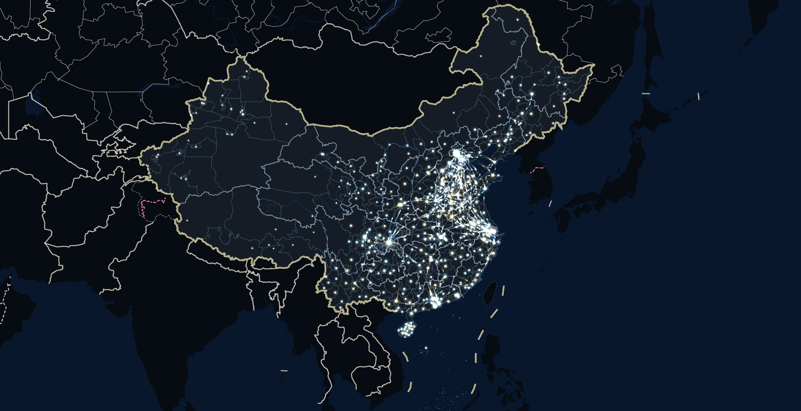
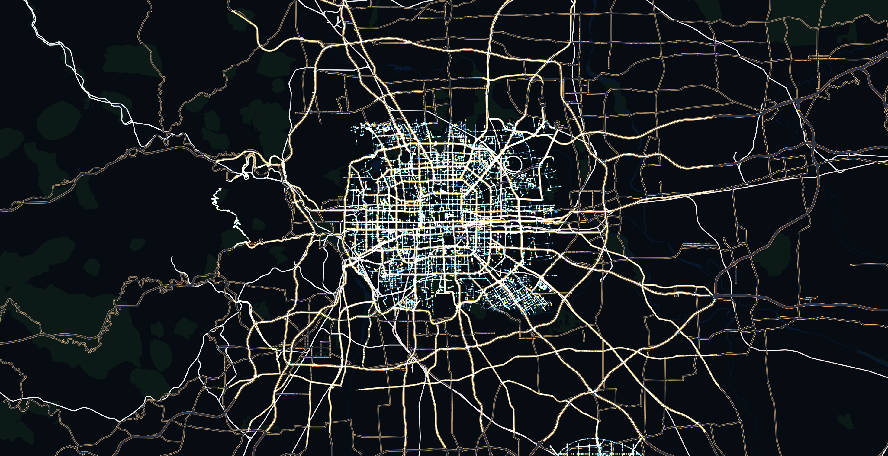
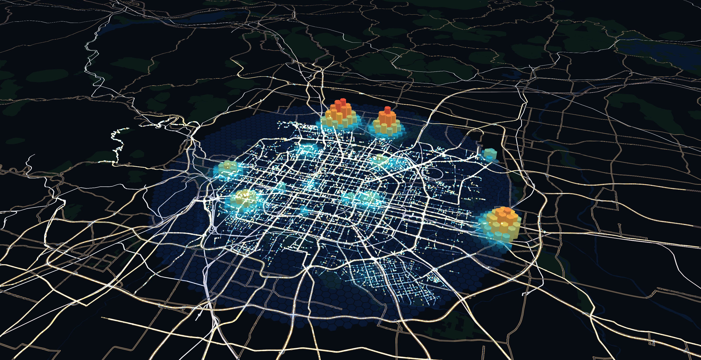
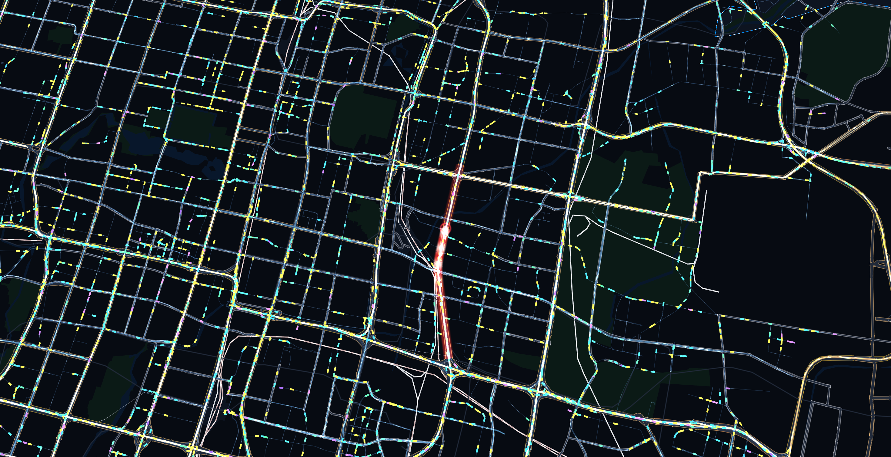

# Apollo 2035 · 全国无人驾驶出行运营中枢

> 基于百度地图 JSAPI 4.0 WebGLLayer 的海量空间数据流式高性能渲染 —— 概念演示（数据为模拟）

设想 2035 年，全国无人驾驶网约车全面普及。运营中枢需要在一张地图上实时看清全国几百万辆车：
它们在哪、在做什么、下一刻城市哪里需要车、急救车怎样穿城而过。

本项目把这个场景作为载体，实现了一套「边下载、边解析、边显示」的海量空间数据渲染方案：

| 要素 | 数据 | 规模（默认档） | 渲染方式 |
|---|---|---|---|
| **点** 车辆 | 仿真 Worker 每秒推送位置快照 | 100 万辆（实测至 800 万） | 点精灵 / 实例化胶囊 + GPU 快照插值 |
| **点** 城市光晕 | 375 座城市（聚合层级） | 375 | 点精灵，数据到达时闪光点亮 |
| **线** 路网 | 8 城 OSM 真实路网（北京 / 上海 / 杭州 / 广州 / 深圳 / 重庆 / 武汉 / 成都，均含支路）+ 367 城合成路网 | 104 万线段 | 实例化线段 + 着色器流光 + 三级 LOD |
| **线** 城际流线 | 引力模型 OD（模拟） | 约 270 条弧 / 1 万段 | 实例化弧段 + 着色器流动光点 |
| **面** 区域 | 全国省市行政区划 GeoJSON | 523 个面 / 48.9 万顶点 | Worker 内 earcut 三角化 |
| **面(3D)** 需求预测 | 六边形网格 | 2,568 个柱体 | 实例化六棱柱 + 深度测试 |

### 关键指标（MacBook Air M2 · 8 GB · Retina · 60 Hz 屏，Chrome 154 / Safari 27）

| 指标 | 结果 |
|---|---|
| 首辆车上屏 | **91 ms**（Safari）/ 199 ms（Chrome），100 万辆 |
| 全部数据上屏（38.7 MB，6 城真实路网时测得；现为 8 城含支路 55.8 MB，待复测） | **0.98 s**（Safari）/ 1.26 s（Chrome），持续加载 31–40 MB/s |
| 交互帧率（平移 / 缩放 / 旋转 / 倾斜） | 100 万、400 万辆均 **60 FPS**，交互期间 0 长任务 |
| 实时仿真最大规模 | **800 万辆、每秒更新、60 FPS**（Chrome）；600 万辆 60 FPS（Safari） |
| 性能余量（关闭垂直同步） | 100 万辆单帧中位数 **6.2 ms**（约 154 FPS） |
| 仿真内核 | WASM 比 JS 快 1.74×（浏览器内，同条件三轮平均）/ 3.3×（Node） |

详见 [`docs/性能测试报告.md`](docs/性能测试报告.md)。



---

## 版本

**v1.0.0（2026-10-16）** —— 参赛提交版
- 四幕演示：全国脉搏 / 城市潮汐 / 网约车需求预测 / 生命通道（120 救护车、119 消防车队 + 警车开道）
- 8 座 OSM 真实路网城市（北京、上海、杭州、广州、深圳、重庆、武汉、成都，均含支路），三个城市级幕均可选城市或 🎲 随机
- `?debug=1` 自动演示（平滑运镜、无人机追车视角、车队光迹、特种车辆图标），随时可手动接管
- 已知：性能报告的加载数据基于 6 城 38.7 MB 版本测得，现数据为 55.8 MB，加载时间待复测

## 快速开始

```bash
npm install
# 浏览器端 AK（百度地图开放平台 → 应用管理 → 浏览器端，Referer 白名单需包含 localhost*）
echo "VITE_BAIDU_AK=你的AK" > .env.local
npm run dev          # http://localhost:5173
```

数据（`public/data/`，约 60 MB）已随仓库提供；如需从源头重建见下文「数据管线」。

### 演示四幕

| 幕 | 直达链接 | 看点 | 技术点 |
|---|---|---|---|
| Ⅰ 全国脉搏 | `/?act=nation` | 375 座城市按人口逐城闪光点亮，城际流线串起城市群 | 分块流式加载、视野优先调度、聚合层级 + 密度自适应 LOD |
| Ⅱ 城市潮汐 | `/?act=tide` | 北京 1 秒 = 3 分钟，早高峰载客车流涌向市中心 | Worker 仿真时钟、GPU 快照插值、路网三级 LOD |
| Ⅲ 网约车需求预测 | `/?act=demand` | 15 分钟后的需求热度以 3D 六边形柱升起；8 座城市可选（北京按真实地点建模，其余按城市结构生成热点） | 实例化六棱柱、双缓冲数值、深度测试 |
| Ⅳ 生命通道 | `/?act=corridor` | 120 救护车或 119 消防车队（警车开道）穿城，镜头跟随，沿途车辆自动靠边让行；8 座真实路网城市可选 | Worker 空间查询、事件图层、反投影跟随 |

| Ⅱ 城市潮汐 | Ⅲ 网约车需求预测 | Ⅳ 生命通道 |
|---|---|---|
|  |  |  |

### URL 参数

| 参数 | 默认 | 说明 |
|---|---|---|
| `fleet` | 1000000 | 车辆总数（实测上限 800 万辆仍约 60 FPS） |
| `zoom` / `center` | 5 / `108.9,34.2` | 初始缩放级别与中心经纬度 |
| `workers` | 核数-2 | 仿真 Worker 数 |
| `wasm` | 1 | `0` 切回 JS 仿真内核（对比用） |
| `lod` | 1 | `0` 关闭密度自适应 LOD（对比用） |
| `orphan` | 0 | `1` 每份快照上传前做缓冲区孤立（对比用） |
| `ub` | 2.5 | 每帧显存上传预算（ms） |
| `roads` / `zones` | 1 | `0` 关闭路网 / 区域面图层 |
| `stress` | 0 | 纯渲染压测：一次性生成 N 辆静态车辆 |
| `act` | — | 打开后自动进入某一幕：`nation` / `tide` / `demand` / `corridor`（`actdelay` 秒后，默认 2.5） |
| `city` | beijing | 配合 `act=tide` / `act=demand` / `act=corridor` 指定城市：`beijing` / `shanghai` / `hangzhou` / `guangzhou` / `shenzhen` / `chongqing` / `wuhan` / `chengdu`，`random` 随机 |
| `event` | ambulance | 配合 `act=corridor` 指定事件：`ambulance`（120 救护车）/ `fire`（119 消防车队：警车开道 + 4 辆消防车） |
| `showcity` | 1 | `0` 关闭全国视角下的城市名（性能测试 `bench` / `fpsdl` 默认关，保持测量条件一致） |
| `glow` / `flow` | 1 | `0` 关闭城市光晕 / 城际流线 |
| `bench` | 0 | `1` 运行内置性能测试（约 1 分钟，镜头自动平移 / 缩放 / 旋转 / 倾斜），结束后弹出「测试数据」悬窗，可下载 JSON / Markdown；加 `autodl=标签` 自动保存 |
| `debug` | 0 | `1` 演示模式：入场完成后自动播放四幕，每幕配一句说明，切幕用平滑运镜（全程约 55 秒）。按鼠标 / 滚轮 / 按键 / 触摸，演示立刻停止，随时可以手动操作。右下角帧率面板始终显示，与此参数无关 |
| `splashms` | — | 入场覆盖层最长停留（毫秒）。默认数据全部上屏约 1.8 秒后自动进入中枢（最长 15 秒） |
| `start` | 1 | `0` 不自动接入，停在入场界面等待点击 |
| `fpsdl` | — | 轻量帧率探针：预热 `warm` 秒后采样 8 秒（含数据新鲜度），结果自动保存 |
| `snap` | — | `名称@秒,…`：读取 WebGL 帧缓冲存为 PNG（无需系统截屏权限） |
| `layoutdl` | — | 版面自检：各悬浮面板的位置与遮挡情况 |
| `gputimer` | 1 | `0` 关闭 GPU 计时查询 |
| `blend` | — | `normal` 强制普通混合（浅色底图调试用） |

测试结果优先 POST 回服务器（`docs/bench/inbox/`），不支持时退回浏览器下载。

---

## 交付物对照

| 赛题交付要求 | 对应内容 |
|---|---|
| (1) 基于 JSAPI WebGLLayer 的高性能渲染应用 | 本仓库 Web Demo；`src/layers/*` 全部基于 `BMap.WebGLCustomLayer` |
| (2) 海量空间数据流式处理模块 | `src/stream/*`、`src/sim/*`、`tools/build-*.mjs`、`wasm/sim` |
| (3) WebGL 高性能渲染模块 | `src/layers/*`、`src/core/gl.js` |
| (4) 性能测试报告 | [`docs/性能测试报告.md`](docs/性能测试报告.md)，测试工具 `src/bench/`、`tools/bench/` |
| 技术文档 | [`docs/技术方案.md`](docs/技术方案.md)、[`docs/00-平台实测.md`](docs/00-平台实测.md) |

---

## 目录结构

```
src/
  main.js               应用入口：图层装配、四幕编排、HUD
  map/baidu.js          JSAPI 4.0 加载、暗色底图样式
  core/projection.js    BD09 → 百度墨卡托（移植自官方运行时）及 WGS84/GCJ02 转换
  core/gl.js            WebGL1 扩展封装（实例化、VAO、GPU 计时）
  layers/
    base.js             图层基类（WebGLCustomLayer 封装 + 真实 GL 绑定保存/还原）
    vehicle.js          车辆：三缓冲快照、GPU 插值、点/胶囊双模式、视锥剔除、LOD
    road.js             路网：实例化线段、沿程流光
    zone.js             区域面：增量上传三角网
    hex.js              需求预测：实例化六棱柱
    event.js            生命通道与救护车
    glow.js             城市光晕（全国视角的聚合层级）
    flow.js             城际流线（引力模型 OD 弧线）
    snap.js             WebGL 帧缓冲快照（文档截图用）
  stream/
    binary.js           流式二进制帧协议（文件头 + 自描述帧，半包安全）
    stream.worker.js    通用流式解析 Worker（fetch ReadableStream → 帧 → 可转移）
    lineFeed.js         路网分块调度（视野优先）
    zone.worker.js      GeoJSON 流式解析 + 坐标转换 + earcut 三角化
  sim/
    fleet.js            车队调度：按数据块负载均衡分配 Worker
    vehicles.worker.js  车辆仿真 Worker（WASM 内核，JS 兜底）
    demand.worker.js    需求预测网格
  bench/bench.js        内置性能测试
  bench/save.js         结果保存（POST 回服务器 / 下载兜底）
wasm/sim/               Rust 仿真内核 → WebAssembly（2 KB）
tools/                  数据抓取、构建、打包与测试脚本
public/data/            分块数据（运行时加载）
docs/                   技术方案、平台实测、性能报告、截图
```

## 性能测试须知

百度地图会识别自动化浏览器（Playwright / Puppeteer / 无头模式）并降级 —— 空地图都只有个位数帧率。
因此所有性能数据都在**普通浏览器、接通电源**的情况下采集（电池电量 ≤ 20% 时 Chrome 会把帧率锁在 30 FPS）：

```bash
npm run build
python3 tools/serve.py 4180 dist      # 生产构建静态服务（原生 arm64，不经 Rosetta）+ 结果回收端
tools/bench/suite.sh                   # Safari / Chrome / Chrome 不限帧，30 万 / 100 万 / 200 万辆
tools/bench/stress-suite.sh            # 纯渲染上限（静态 200 / 400 / 800 万辆）
tools/bench/chrome-real.sh "http://localhost:4180/?bench=1&fleet=1000000&autodl=1m" bench-1m.json 300
tools/bench/safari-real.sh "http://localhost:4180/?bench=1&fleet=1000000&autodl=1m-sf" bench-1m-sf.json 300
```

结果写入 `docs/bench/inbox/`，整理后的数据见 [`docs/性能测试报告.md`](docs/性能测试报告.md)。

截图：`tools/bench/snap.sh` 只读 WebGL 帧缓冲（不含 HUD）；带界面的整页截图用
`tools/bench/cdpshot.sh "<url>" out.png 1470x880 10`（无头 Chrome，真实时钟，第 5 个参数可附带一段页面内求值的 JS）。

## 数据管线

```bash
npm run data:fetch   # OSM 真实路网（Overpass）+ DataV 行政区划，写入 data-src.noindex/
npm run data:build   # 路线池 / 路网线段 / 区域 NDJSON / 分块打包，写入 public/data/
npm run wasm:build   # 需要 rustup 与 wasm32-unknown-unknown 目标
```

## 数据来源与许可

- 道路：© OpenStreetMap contributors（ODbL），经 WGS84 → GCJ02 → BD09 转换
- 行政区划：DataV.GeoAtlas（阿里云）
- 底图与版权信息：百度地图 JSAPI 4.0 自带（含 HERE 数据版权），按要求保留在左下角，仅降低不透明度以适配暗色界面（`?style=0` 可切回原生底图对照）
- 车辆、需求、事件：全部为程序生成的模拟数据；「2035」「Apollo」为概念演示设定，不代表官方数据或产品

代码以 [Apache License 2.0](LICENSE) 开源；第三方数据与服务的署名见 [NOTICE](NOTICE)。
